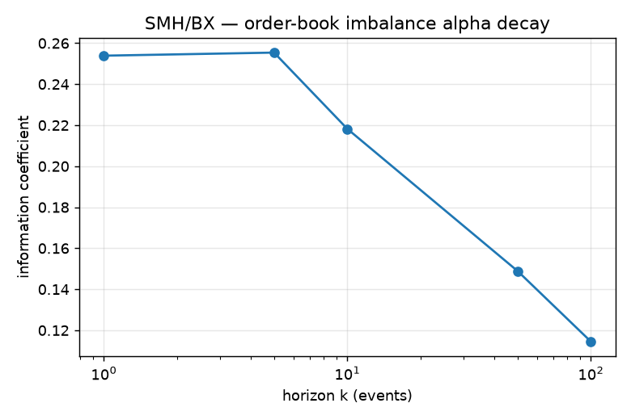

# Microstructure study — order-book imbalance on SMH (Nasdaq BX)

A short research study built on top of the feed handler: does the limit order
book predict its own next move? Data: `20190130.BX_ITCH_50` (Nasdaq BX, full day).

## Question

Does **order-book imbalance** — the relative size resting on the bid vs. the
ask — predict the sign of the next change in the mid-price, and over what
horizon does that predictive power decay?

## Method

- **Symbol:** SMH, selected as the most-active name on the feed by message
  count (475,835 messages), via `itch_topsym`. ETF market-making dominates BX
  traffic; this is a single-venue (BX) book, not consolidated.
- **Feature series:** `itch_features` replays the day through the reconstructed
  book and emits one row per **top-of-book change** — event-time sampling,
  which matches the bursty flow (median inter-event gap 0.64 ms, but p99.99
  ≈ 3.85 s). 361,031 L1 updates over regular trading hours (09:30–16:00).
- **Signal:** imbalance `I = (bid_sz − ask_sz) / (bid_sz + ask_sz) ∈ [−1, 1]`.
  (Microprice tilt is algebraically `(spread/2)·I`, so it is the *same* signal,
  not an independent one — confirmed by identical rank IC.)
- **Label:** forward mid-price change over the next *k* events, `mid(t+k) −
  mid(t)`, strictly in the future (no lookahead).
- **Metric:** Spearman rank correlation of signal vs. forward return — the
  information coefficient (IC).

## Results

| horizon k (events) |   1   |   5   |  10   |  50   | 100   |
|:------------------:|:-----:|:-----:|:-----:|:-----:|:-----:|
| IC (imbalance)     | 0.254 | 0.255 | 0.218 | 0.149 | 0.115 |

- **A real, sizable short-horizon signal.** IC ≈ 0.25 at k=1, holding flat
  through k=5, then decaying monotonically — a clean alpha-decay curve.
- **Stable out-of-sample.** Splitting the day in half: IC@10 = 0.212 (morning)
  vs. 0.229 (afternoon). The edge is stationary, not an artifact of one window.
- **But below trading costs.** Regressing the forward mid move on imbalance
  gives **0.33 cents per unit imbalance** — so even a maximally one-sided book
  predicts ~0.33¢, against a **1¢ half-spread** (median spread 2¢).

## Conclusion

L1 order-book imbalance on SMH/BX is a **strong, stable directional predictor
of the next mid move (IC ≈ 0.25, robust out-of-sample), but its magnitude sits
below the half-spread** — so it is not tradeable as a standalone
spread-crossing signal. Its value is in **execution and queue positioning**
(which side to post, when to expect the mid to tick), not as an alpha you pay
the spread to capture.

## Limitations & next steps

- Single day, single symbol, single venue (BX). Replicate across days/names.
- Order-flow imbalance (OFI, signed top-of-book size changes) is the natural
  next feature — often a stronger predictor than static imbalance.
- Deeper book (top-N levels) and a proper transaction-cost model for the
  execution-signal framing.